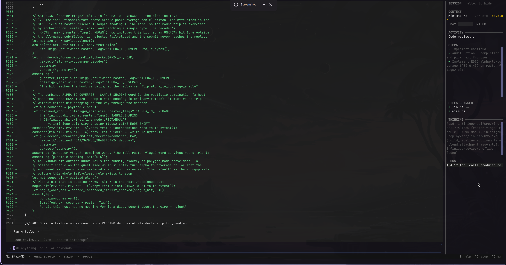

# Infinidev

[](https://pypi.org/project/infinidev/)
[](https://pypi.org/project/infinidev/)
[](https://github.com/Infinibay/infinidev/actions/workflows/tests.yml)
[](LICENSE.md)

Infinidev is a coding agent for real repository work, from a focused bug fix to
a change that takes many steps. It can investigate a problem, plan and implement
a solution, run checks, review changes, and carry project knowledge into later
sessions. You work with it through a terminal or the web workspace.

The product targets capable reasoning and coding models with long context
windows. Hosted providers work through LiteLLM, including the existing ChatGPT
subscription integration. Local models through [Ollama](https://ollama.com)
remain supported. Choose a model for the task; small local models do not set
the architecture or the quality bar.

An optional React web workspace provides conversations, named teams and tickets,
shared notes, live process output, file diffs, findings, model settings and usage.
It drives the same harness as the terminal. See [Web workspace](docs/web-harness.md)
for setup, development and the current scope.



## Install

Python 3.11 or newer is required. The recommended installation uses
[uv](https://docs.astral.sh/uv/), which keeps Infinidev in an isolated tool
environment:

```bash
uv tool install infinidev
```

Upgrade later with:

```bash
uv tool upgrade infinidev
```

You can also install it with pipx:

```bash
pipx install infinidev
```

## Start

Run Infinidev from the project you want it to work on:

```bash
cd path/to/your/project
infinidev
```

Use `/models manage` to choose a provider and model, or `/settings` to edit the
project configuration. Select your provider explicitly before starting work.
For the ChatGPT subscription provider (`openai_subscription`), Infinidev reuses
the Codex CLI login established by `codex login`; it reads the available models
and their limits from the CLI's cached catalog. Other hosted providers use their
configured credentials.

Fresh configurations currently default to Ollama at `http://localhost:11434`;
that is a compatibility default, not a requirement to run a local model.

Useful command-line modes:

```bash
infinidev --no-tui                 # text-only interface
infinidev -p "explain this repo"   # one prompt, then exit
infinidev --continue               # resume the latest local session
infinidev --resume                 # choose, rename, or delete a previous session
```

Inside either interface, use `/session <name>` to give the current session a durable
name. The `--resume` picker shows all sessions registered in the active workspace database
(local-workspace entries first), including their names and estimated storage; enter
`rename NUMBER NAME` or `delete NUMBER` to manage an entry before resuming it.

Use `/prompts` to list the optional prompt capabilities in your shared catalog, narrow
that list with `/prompts search <term>`, and inspect a guide before activation with
`/prompts show <name>`. Then use `/prompts enable <name>` or `/prompts disable <name>`
to change one for future tasks. Use `/prompts reset <name>` to remove your override and
inherit the catalog or project state again.
Shared profiles live in `~/.infinidev/prompts/`; a project's
`.infinidev/prompts.json` can override them. See [Prompt profiles](docs/prompt-profiles.md)
for the catalog format and precedence rules.

## What it includes

- A live terminal UI with task progress, diffs, files, logs, and context usage.
- Live output tabs for background commands through `/ps` or `/bg`.
- Research teams with named specialists, visible roles, shared notes, and direct messages.
- Plan-execute-summarize and staged execution for long, multi-step tasks.
- File, shell, Git, web, code-intelligence, knowledge, and image tools.
- Persistent, searchable working memory with recoverable tool evidence.
- Project and user-level prompt profiles, with opt-in workflow guides managed through `/prompts`.
- Model capability detection and native or text-based tool calling.
- MCP server support; Ken is used for semantic project context when available.
- Permission checks, deterministic completion gates, tests, and post-change review.
- Image attachments, terminal image viewing, and opt-in image generation.

## Working on a longer task

Describe the result you need, the constraints that matter, and how you will know
it works. For example:

> Find why failed uploads leave orphaned files. Fix the cause, preserve the
> current API, and add a regression test. Explain any migration I need to run.

Use `/plan <task>` when you want to inspect the route before execution. Plans
can adapt as evidence changes, while explicitly approved scope stays protected.
Use `/session <name>` to name the conversation and `--continue` or `--resume` to
return later. Notes, summaries, and searchable tool evidence support continuity;
old command output can be recalled without running the command again. Facts
that may have changed still need to be checked against the current workspace.

The default engineering guidance asks the agent to fill routine gaps with
reversible choices, compare a simple baseline with alternatives for open design
questions, and explain decisions in your language. Product choices that remain
ambiguous, destructive actions outside your authorization, and missing access
still need your input.

## What makes a result trustworthy

- Tool schemas validate arguments, and execution uses the configured permission
  policy. A prompt alone is not an authorization boundary.
- With objective verification enabled (the default), a planned deterministic
  check can refuse a step's completion. If corrections are exhausted, the step
  closes as blocked with the failure evidence. A verifier error cannot count as
  a pass, and a failed recheck revokes that step's earlier positive evidence.
- Recognized failing tests can veto a successful task close. Post-change review
  and objective re-verification provide additional checks across steps.
- A rejected evidence review blocks an informational task too. Invalid reviewer
  responses cannot count as approval. Cancelled, blocked, or failed rework stops
  later review operations and keeps the partial result; an operation already
  running may still finish.
- The agent should report what changed, which checks ran, and what remains
  uncertain. A passing check establishes only the behavior it exercises.

These mechanisms help expose mistakes. They do not guarantee that every design
choice is correct or that an untested path works. Review the diff and the
verification scope before relying on a consequential change.

See [Reliability and engineering judgment](docs/AGENT_RELIABILITY.md) for the
implemented checks, evaluation limits, and next work to measure.

## Essential commands

| Command | Purpose |
| --- | --- |
| `/help` | Show commands and keybindings |
| `/models manage` | Choose the active provider and model |
| `/settings` | View or change project settings |
| `/engine` | Select the task execution engine |
| `/plan <task>` | Review a plan before execution |
| `/mcp` | Show MCP server health |
| `/findings` | Browse saved project knowledge |
| `/ps` or `/bg` | Select a background task and open its live output |
| `/usage` | Show usage and available quota information for the selected provider |
| `/reindex` | Rebuild the local code index |
| `/clear` | Clear the transcript |
| `/exit` | Quit |

## How it works

```text
request
  -> principal agent
  -> direct work or tickets and delegated specialists
  -> evidence, tests, and objective checks
  -> principal review
  -> result
```

Infinidev stores settings, history, logs, and its SQLite knowledge database in
`.infinidev/` inside the current project. Environment variables use the
`INFINIDEV_` prefix. Secrets and generated runtime state should not be committed.

Council transcripts shown by `/agents` are process-local and retain the 100 most
recent completed councils by default, while always preserving active councils. Set
`COUNCIL_HISTORY_LIMIT` in `.infinidev/settings.json` (or
`INFINIDEV_COUNCIL_HISTORY_LIMIT`) to a non-negative number; use `0` to discard a
transcript after its completion event or `null` for unlimited retention.

See [Background tasks](docs/background-tasks.md) for output tabs and shortcuts,
[Research teams](docs/research-teams.md) for delegation and shared notes, and
[Provider usage](docs/usage.md) for quota sources and optional billing credentials.

## Development

```bash
git clone https://github.com/Infinibay/infinidev.git
cd infinidev
uv sync
uv run pytest
uv run infinidev
```

Architecture and subsystem documentation live in [`docs/`](docs/). Contributor
guidance is in [`AGENTS.md`](AGENTS.md).

## License

The Infinidev software and documentation are available under the [MIT License](LICENSE.md).
The manually authored task-policy annotations in
[`data/task-policy-reviews/`](data/task-policy-reviews/) are a separately licensed data
component; see their [data license and attribution notice](data/task-policy-reviews/LICENSE.md).
